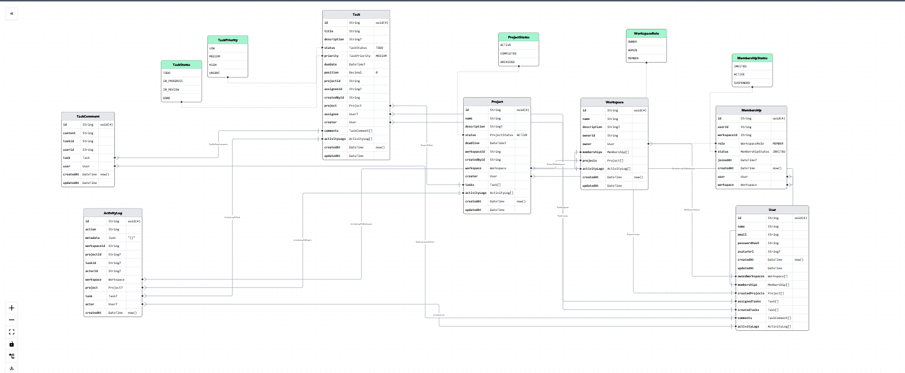

# TaskMatrix 🚀

**TaskMatrix** is a collaborative project and task management platform that helps teams organize projects, assign tasks, track progress, and collaborate efficiently from a shared workspace.

## 1. Project Overview

TaskMatrix is a full-stack project management application inspired by platforms like **Jira, Trello, and Asana**.

It provides teams with a centralized workspace where they can:

- Create and manage projects.
- Break projects into smaller, manageable tasks.
- Assign tasks and responsibilities to team members.
- Track project progress through a Kanban board.
- Collaborate through task-level comments.
- Monitor activities and project updates.

The primary goal is to build a practical and scalable collaboration platform backed by a reliable relational database and a modular backend architecture that can support real-time communication and background job processing.

## 2. Designated Track

**Full-Stack Development**

The project focuses on building a complete full-stack application with the following components:

- Responsive frontend application.
- Backend REST API.
- Relational database architecture.
- User authentication and authorization.
- Workspace and team management.
- Project and task management.
- Real-time collaboration capabilities.

## 3. Technology Stack

| Frontend | Next.js, TypeScript |

| Styling | Tailwind CSS |

| Backend | Node.js, Express.js, TypeScript |

| Database | PostgreSQL |

| Background Jobs | Redis |

| Real-Time Communication | Socket.IO |

## 4. Core Features and Priorities

Features are divided into three priority levels based on their importance and implementation scope.

### P0 — Must Have

These are the essential features required for the initial working version of TaskMatrix.

- **Authentication:** User registration, login, logout
- **Workspace Management:** Create workspaces, with the creator automatically assigned as the workspace owner.
- **Team Membership:** Add or invite members and assign workspace roles such as Owner, Admin, and Member.
- **Project Management:** Create, view, update, and archive projects within a workspace.
- **Task Management:** Create, view, update, and delete tasks with details such as title, description, priority, due date, and status.
- **Task Assignment:** Assign tasks to workspace members.
- **Kanban Board:** Organize and track tasks across four columns:
  - `TODO`
  - `IN_PROGRESS`
  - `IN_REVIEW`
  - `DONE`
- **Task Comments:** Allow team members to discuss and share updates within individual task detail views.

### P1 — Should Have

These features improve collaboration, usability, and overall user experience.

- **Activity History:** Maintain a record of important actions, including task creation, assignments, and status changes.
- **Real-Time Updates:** Broadcast task and Kanban board changes to authorized project members using Socket.IO.
- **Search and Filters:** Filter tasks by status, priority, assignee, and due date.
- **Pagination and Sorting:** Efficiently retrieve and organize projects and tasks as the application grows.
- **In-App Notifications:** Notify users about task assignments, comments, and relevant project updates.

### P2 — Could Have

These are additional features that can make the platform more powerful and scalable.

- **Background Processing:** Use Redis  to handle asynchronous tasks, such as notification delivery.
- **Deadline Reminders:** Schedule automated reminders for upcoming task deadlines.
- **Project Analytics:** Display project progress, task completion statistics, and productivity summaries.
- **Project-Level Chat:** Introduce a dedicated discussion channel for each project, if time permits.

**DATABASE SCHEMA:**

## 5. Project Vision

TaskMatrix aims to provide teams with a simple, centralized, and efficient way to manage their projects and daily tasks.

By combining project management, team collaboration, real-time communication, and a scalable backend architecture, the platform will serve as a practical solution for organizing and managing team workflows.

**Figma Design:** 
[View TaskMatrix UI/UX Designs](https://www.figma.com/design/p4ecp86rPLgz3gcVx6wtJZ/Untitled)

